<p align="center">
  <strong>English</strong> · <a href="README_zh.md">中文</a>
</p>

<p align="center">
  
</p>
<h1 align="center">Where Papers Go</h1>

<p align="center">
  <strong>Journal retrieval with paper evidence</strong><br>
  A venue-discovery toolkit and benchmark study of journal profiles, historical papers, and rank fusion.
</p>

<p align="center">
  <a href="https://www.python.org/"></a>
  <a href="https://github.com/rudykon/Where_Papers_Go/actions/workflows/tests.yml"></a>
  <a href="#retrieval-pipeline"></a>
  <a href="#data-coverage"></a>
  <a href="LICENSE"></a>
</p>

<p align="center">
  <a href="#overview">Overview</a> ·
  <a href="#paper-study">Paper &amp; Results</a> ·
  <a href="#product-tour">Product Tour</a> ·
  <a href="#retrieval-pipeline">Pipeline</a> ·
  <a href="#quick-start">Quick Start</a> ·
  <a href="#data-coverage">Data</a> ·
  <a href="#repository-map">Repository</a> ·
  <a href="#license">License</a>
</p>

> [!IMPORTANT]
> **Where Papers Go is a venue-discovery assistant, not an acceptance predictor.** Rankings express topic fit within the available data. Always verify the latest aims and scope, Call for Papers, deadlines, and submission rules on the official venue website.

**[Open the browser edition](https://rudykon.github.io/Where_Papers_Go/)** — search
the public venue catalog locally in your browser, with no account or API keys.
Queries stay on your device. This static edition uses its own Worker-based retrieval;
the Python service below provides the strict online pipeline.
See [build, deployment, and algorithm details](docs/github-pages.md).

<a id="overview"></a>
## Overview

Where Papers Go turns a paper title, abstract, keyword set, or early research idea into a ranked list of conferences and journals. It is designed for both precise technical descriptions and fuzzy, cross-domain expressions that keyword dictionaries alone cannot cover.

| Edition | Method | Purpose |
| --- | --- | --- |
| [Browser demo](https://rudykon.github.io/Where_Papers_Go/) | Local BM25 + TF-IDF + keyword graph | Venue lookup and topic search without API keys |
| [Paper benchmark](#paper-study) | Paper BM25 + SciNCL + two-level RRF | Offline publication-venue recovery over 20,087 journals |
| Python application | LightRAG + embeddings + LLM + Search API | Configured online retrieval and evidence review |

Key product behavior:

- CCF, TH-CPL, CAS, and JCR targets can be combined; multiple target tiers use **OR** semantics.
- Topic retrieval strictly uses **LightRAG + exact vector retrieval + LLM + Search API**. It does not silently downgrade when one layer fails.
- Search, vector, and LightRAG work are parallelized; LLM reranking uses two concurrent batches.
- A formal **offline SCOPE-Rank research implementation** now covers adaptive recall, train-only fusion, constraints, abstention, and provenance explanations. The learned full method is a statistically significant negative result on both exposed development and the qualified future evaluation below; it is not evidence that the product ranking is better. Fixed linear/RRF alternatives remain explicit ablations.
- Complete results and API responses are cached, while the web UI streams progress and available recommendations.
- The runtime query layer is a rebuildable file-based property graph—no Neo4j service is required.

<a id="paper-study"></a>
## Paper study

**Where Papers Go: A Benchmark Study of Paper-Evidence Journal Retrieval**

The study combines journal profiles with historical paper evidence and evaluates candidate coverage, publication-venue recovery, and model evidence assessment separately.

<p align="center">
  <a href="website/assets/paper-overview.png">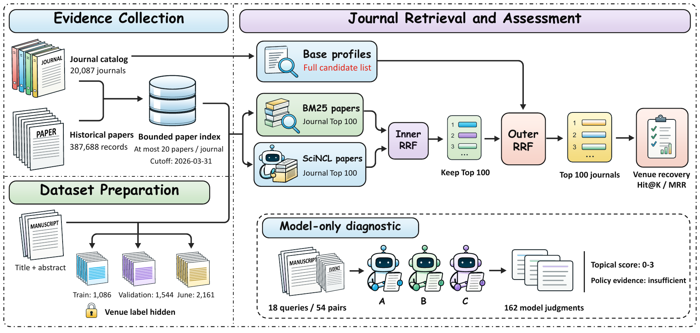</a>
</p>

### Method and dataset

- **Bounded evidence:** 20,087 candidate journals and 387,688 historical papers, at most 20 per journal, with recorded dates bounded by March 31, 2026.
- **Paper retrieval:** BM25 and SciNCL retrieve separately, aggregate by each journal's highest paper score, and each retain 100 journals.
- **Two-level RRF:** fuse the paper lists and keep 100 journals, then fuse with the complete Base journal-profile ordering. Both stages use equal weights and a rank constant of 60. The outer paper-channel budget is fixed; the hybrid adds dense retrieval computation.

<p align="center">
  <a href="website/assets/paper-data.png">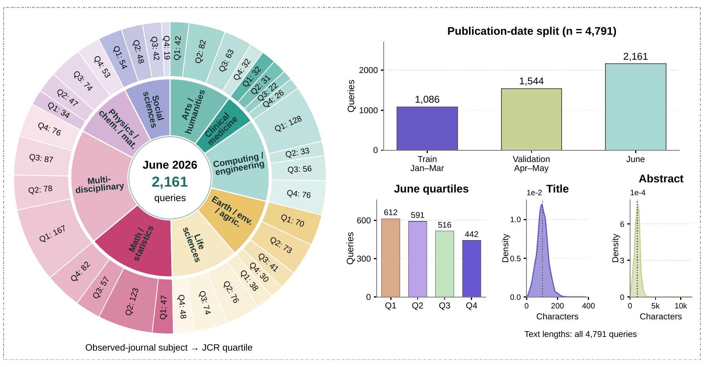</a>
</p>

The 4,791 queries are split by publication date: 1,086 training, 1,544 validation, and 2,161 June development queries. June covers nine subject groups and four JCR quartiles. A separate 300-query July cohort evaluates earlier systems.

### Main results

Paper Table 2: **2,161 June queries exposed during development**. Hit metrics measure publication-venue recovery; MRR is unscaled, and — means unreported.

| Method | Hit@1 (%) | Hit@5 (%) | Hit@10 (%) | MRR@10 | Pool recall (%) | Mean pool size |
| --- | --- | --- | --- | --- | --- | --- |
| Base | 3.38 | 11.15 | 16.01 | 0.0660 | 51.09 | 206.82 |
| BM25 (recent) | 6.89 | 17.63 | 23.65 | 0.1161 | — | — |
| BM25 (diverse) | 6.80 | 15.96 | 22.77 | 0.1089 | — | — |
| SciNCL | 5.83 | 15.22 | 21.15 | 0.0986 | — | — |
| Base + BM25 | 5.92 | 17.26 | 23.92 | 0.1082 | 71.36 | 281.68 |
| Base + diverse BM25 | 6.25 | 17.35 | 23.60 | 0.1097 | 69.18 | 283.07 |
| Base + SciNCL | 5.23 | 16.43 | 23.97 | 0.1003 | 70.48 | 276.97 |
| Base + hybrid | 5.46 | 18.42 | 26.19 | 0.1098 | 72.98 | 277.37 |
| Catalog CE | 2.59 | 10.00 | 18.37 | 0.0610 | — | — |
| Catalog + papers CE | 3.47 | 13.47 | 22.21 | 0.0787 | — | — |

Base + hybrid reaches **26.19% Hit@10**, **2.27 percentage points** above Base + BM25 (95% paired interval **[1.20, 3.29]**; Holm p = 0.0064 across 32 tests). Recent-paper BM25 has higher Hit@1 (6.89%) and MRR@10 (0.1161). Both cross-encoder rerankers trail their Base + BM25 input. The final hybrid has no independent future-period validation.

<p align="center">
  <a href="website/assets/paper-retrieval-depth.png">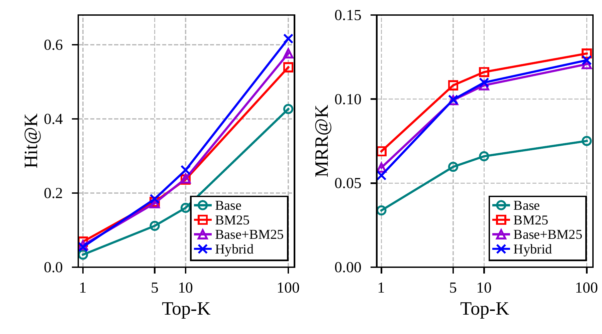</a>
</p>

Figure 6 shows only measured cutoffs k = 1, 5, 10 and 100. Hybrid Hit@100 is 61.64%, below 72.98% full-union recall, exposing the gap between candidate coverage and final ordering.

<details>
<summary>Aggregation, model assessment and cases (Figures 3, 4, 5, 7 and 8)</summary>

### Paper-evidence aggregation

<p align="center">
  <a href="website/assets/paper-aggregation.png">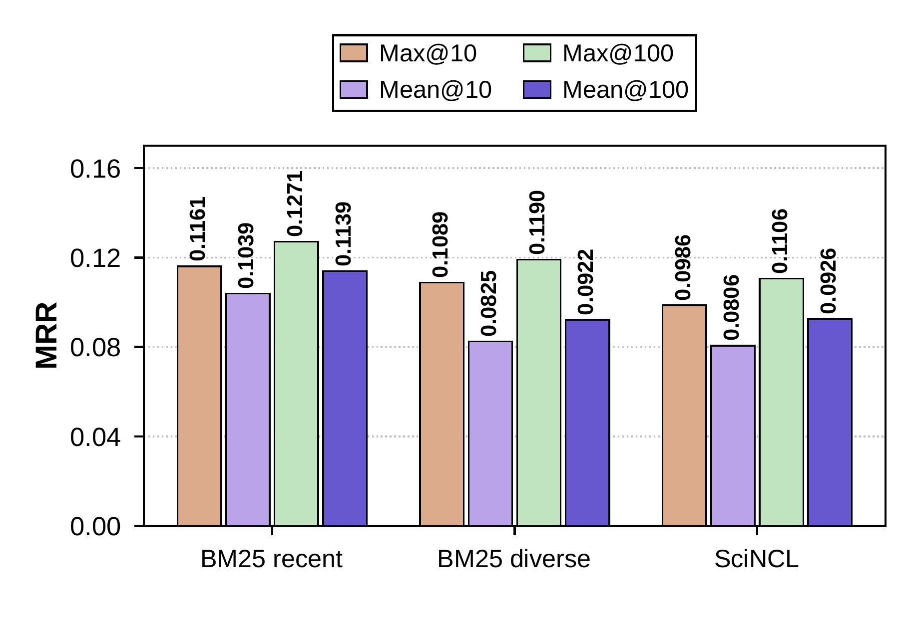</a>
</p>

Holding each index and retriever fixed, max aggregation beats the mean of up to three paper scores at both MRR@10 and MRR@100.

### Model evidence assessment

<p align="center">
  <a href="website/assets/paper-task-format.png">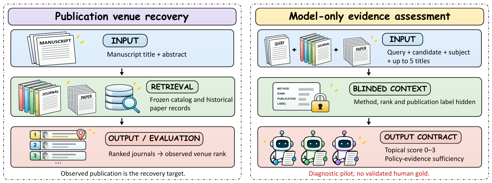</a>
</p>

Three same-family models in separate fresh contexts rated 54 manuscript–journal pairs from 18 queries: **162 model judgments and 0 human judgments**. Exact pairwise agreement is **79.63–87.04%**, with weighted κ of **0.882–0.921**. These are consistency measures. Official policy text was absent, so all 162 policy-evidence judgments were insufficient.

<p align="center">
  <a href="website/assets/paper-consistency.png">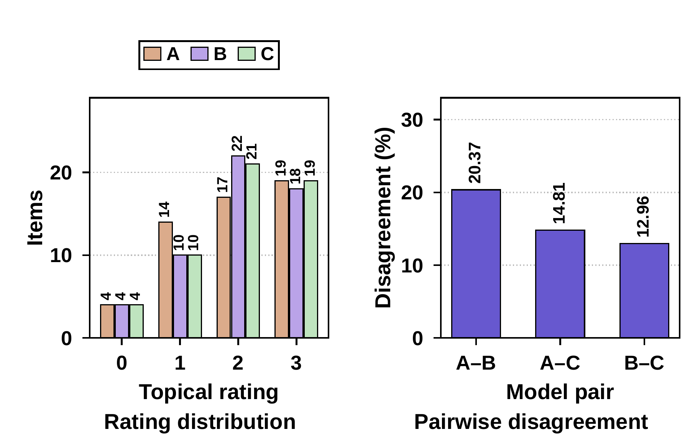</a>
</p>

### Case analysis

<p align="center">
  <a href="website/assets/paper-supported-cases.png">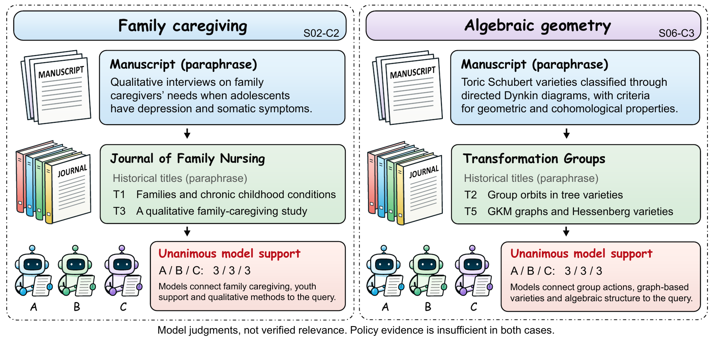</a>
</p>

The family-caregiving and algebraic-geometry examples receive topical ratings of 3 / 3 / 3.

<p align="center">
  <a href="website/assets/paper-difficult-cases.png">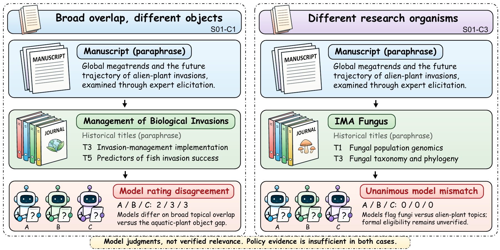</a>
</p>

Alien-plant examples receive 2 / 3 / 3 and 0 / 0 / 0, illustrating disagreement and topical mismatch. Cases were selected by frozen conditions and item IDs, without human validation of suitability; policy evidence is insufficient in all four examples.

</details>

[Explore the paper on the website](https://rudykon.github.io/Where_Papers_Go/#research) · [Experimental scope, all tables and figure provenance](docs/paper-study.md)

<a id="product-tour"></a>
## Python application tour

The Python application provides querying, scope controls, ranked recommendations, and evidence review. The screenshots below show that service.

| Search broadly | Follow every stage | Verify the recommendation |
| --- | --- | --- |
| Describe a paper in natural language and combine venue constraints. | A persistent progress dock stays visible while scrolling. | Open any result to inspect scope boundaries, retrieval signals, and external evidence. |

### 1. Describe the work and set the scope

Enter a title, abstract, or research idea, then expand **Submission scope** only when you need to restrict tiers, venue type, area, or result count.

<p align="center">
  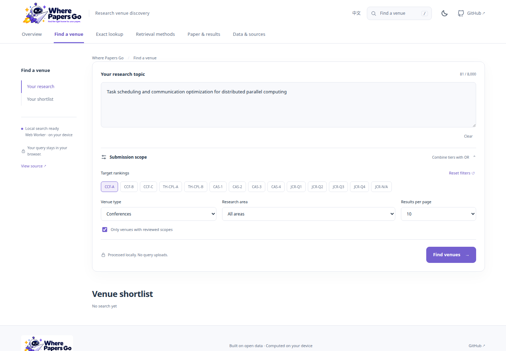
</p>

### 2. Review ranked results as retrieval completes

Recommendations stream into the page while the bottom dock reports LLM intent parsing, vector recall, LightRAG, and Search API progress from any scroll position.

<p align="center">
  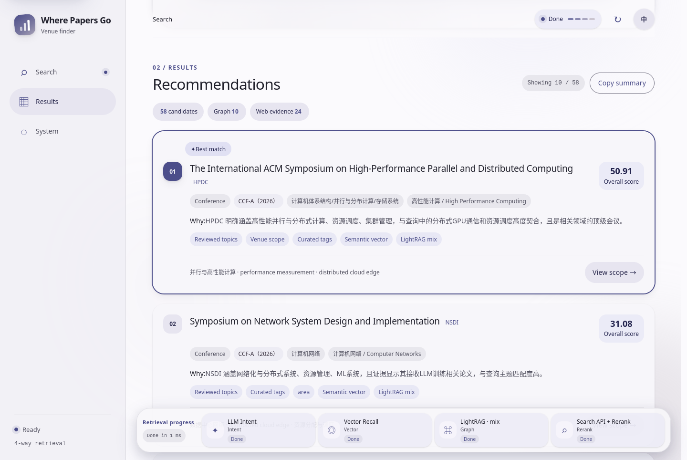
</p>

### 3. Inspect scope and evidence

Open **View scope** to compare covered topics, explicit exclusions, contributing retrieval signals, and external or official evidence before submitting.

<p align="center">
  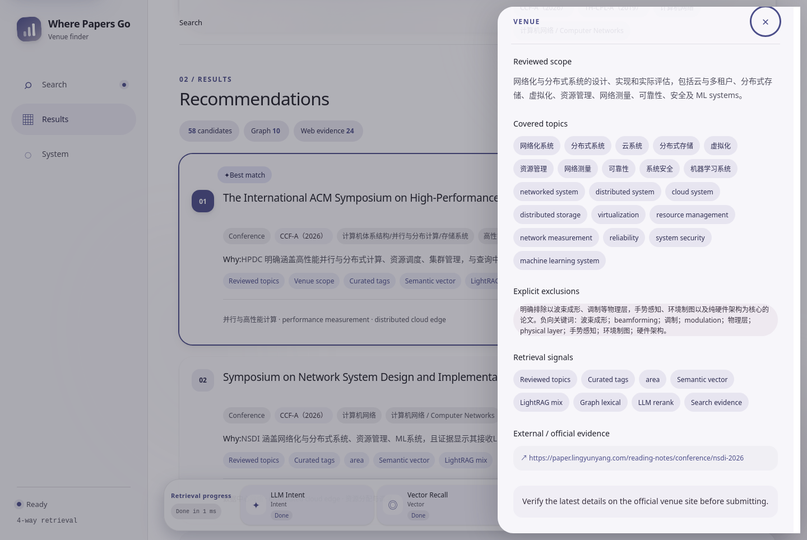
</p>

<p align="center"><sub>Screenshots use a cached example query from the running application. Rankings and evidence may change as source data and APIs are updated.</sub></p>

<a id="retrieval-pipeline"></a>
## Retrieval pipeline

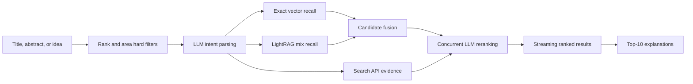

The file-based property graph stores venues, tiers, topics, reviewed scopes, exclusions, and evidence as nodes and edges. Source CSV/TSV files remain the auditable facts; graph, vector, LightRAG, and cache files are rebuildable artifacts and are excluded from Git.

Exact cosine recall uses a preloaded NumPy matrix while retaining the scalar implementation as a quality-regression reference. The Python service worker pays the matrix-build cost during startup, not on the first user query.

See [retrieval architecture](docs/retrieval-architecture.md) for scoring, failure boundaries, caching, and storage details.

<a id="quick-start"></a>
## Quick start

### 1. Install

```bash
git clone https://github.com/rudykon/Where_Papers_Go.git
cd Where_Papers_Go

python3 -m venv .venv
source .venv/bin/activate
python3 -m pip install --upgrade pip
python3 -m pip install -e .
```

### 2. Configure the required APIs

```bash
cp api.example.json llmapi.json
```

Edit `llmapi.json` and complete all three sections:

| Section | Purpose | Typical choice |
| --- | --- | --- |
| `llm` | Query understanding, candidate reranking, explanations | OpenAI-compatible chat model |
| `embedding` | Multilingual semantic vectors | bge-m3 or another multilingual embedding model |
| `search` | Current scope/CFP evidence | Tavily, Brave, Bing, or SerpAPI |

`llmapi.json` is ignored by Git. Never put real credentials in `api.example.json`.
For Tavily key rotation, put keys in `search.api_keys`; the persistent pool tracks
the per-key quota, round-robin cursor, cooldowns, and exhausted keys without storing
plaintext credentials in its state file.

### 3. Build the retrieval artifacts

```bash
python3 -m scripts.prepare_retrieval --api-config llmapi.json
```

This creates the property graph, exact venue vectors, and the LightRAG `mix` knowledge base. The first build can take time; later runs reuse the artifacts and embedding cache.

### 4. Start the web app

```bash
where-paper-go-web --host 127.0.0.1 --port 8000
```

Open `http://127.0.0.1:8000/` locally. For a temporary trusted-LAN listener,
explicitly replace the example subnet with the real LAN and keep loopback:

```bash
WPG_ALLOWED_CLIENT_CIDRS=127.0.0.0/8,::1/128,192.168.1.0/24 \
  where-paper-go-web --host 0.0.0.0 --port 8000
```

Requests from every other direct peer are dropped before a handler thread is
created. The interface supports Chinese/English switching, combined scope
filters, persistent retrieval progress, streamed results, and evidence details.

For a restartable production service, strict readiness, HTTPS/auth proxy,
request limiting/audit, shadow upgrade, and recoverable rollback, follow the
[production deployment runbook](docs/production-deployment.md). A direct
`0.0.0.0` listener is a trusted-LAN transition only, not an Internet-facing
deployment.

The audited host deployment as of 2026-08-30 is intentionally loopback-only at
`http://127.0.0.1:8001/`. Its user-systemd unit is enabled and active and has
passed explicit restart and forced-process-termination recovery checks. It is
not currently exposed to the LAN or Internet: Nginx is not installed, and
administrator TLS/auth proxy activation plus a literal host reboot remain
manual gates.

<details>
<summary><strong>CLI examples</strong></summary>

List all CCF-A venues without running the API-assisted topic pipeline:

```bash
where-paper-go --target CCF-A --all
```

Recommend venues for a fuzzy research description:

```bash
where-paper-go \
  --target 'CCF-A或者THCPL-A或者中科院1区' \
  --query 'A general framework for heterogeneous supervision with missing labels, uncertainty, conflicts, hierarchies, and multitask learning' \
  --api-config llmapi.json \
  --limit 20
```

Search JCR Q1–Q4 journals in medicine:

```bash
where-paper-go \
  --target 'JCR-Q1,JCR-Q2,JCR-Q3,JCR-Q4' \
  --record-type journal \
  --area medicine \
  --query-file abstract.txt \
  --api-config llmapi.json
```

Machine-readable output is available through `--format json` and `--format csv`. Run `where-paper-go --help` for every option.

</details>

<a id="data-coverage"></a>
## Data coverage

| Ranking source | Edition | Records | Venue type | Tiers |
| --- | ---: | ---: | --- | --- |
| CCF | 2026 | 386 | Conferences | A / B / C |
| TH-CPL | 2019 | 406 | Conferences and journals | A / B |
| CAS journal partition | 2025 | 21,772 | Journals | 1 / 2 / 3 / 4 |
| JCR | 2025 | 22,643 | Journals | Q1 / Q2 / Q3 / Q4 / N/A |

The reviewed fine-grained scope catalog covers all 58 CCF-A conferences, all 117 TH-CPL-A venues, and all 53 CAS Zone 1 computer-science journals. Overlapping venues reuse one reviewed scope record, so these counts should not be added as unique entities.

The completed local candidate-side acquisition snapshot dated 2026-03-31 contains all 20,087 JCR Q1--Q4 venue profiles and historical-paper evidence for 19,593 venues (97.54%). A separate date-bounded, leakage-audited research derivative now covers the same 20,087-candidate universe: every research record is bounded by the 2026-03-31 cutoff, all warm/few-shot venues have paper-backed prototypes, and the P0-C frozen-run/leakage gates passed on all 4,791 exposed development queries. The ignored acquisition and research artifacts remain distinct from the reviewed product scope overlay above; these results establish the offline experimental baseline, not a validated SCOPE-Rank gain.

Source details and validation rules are documented in [`data/README.md`](data/README.md). Ranking names, third-party data, and source descriptions remain subject to their respective terms.

<a id="validation"></a>
## Validation

```bash
PYTHONDONTWRITEBYTECODE=1 python3 -m unittest discover -s tests -v
python3 -m scripts.benchmark_retrieval
```

The test suite covers target expressions, source counts, entity merging, graph integrity, fuzzy graph paths, exact semantic recall, LightRAG references, API constraints, streaming behavior, caching, and representative topic rankings.

### Leakage-audited research benchmark

The `research` package isolates paper experiments from the live product path: it never imports or calls the LLM/Search clients, keeps every failed retrieval in the denominator, freezes venue profiles at the training cutoff, and audits DOI/title/time leakage before scoring.

```bash
python3 -m research build-cached-corpus \
  --cache-dir benchmark_artifacts/recent_journals/crossref_cache \
  --jcr-csv data/jcr_partition_2025.csv \
  --output-dir benchmark_artifacts/research_20260814/cached_crossref \
  --start 2026-01-01 --train-end 2026-03-31 \
  --dev-end 2026-05-31 --test-end 2026-06-30

python3 -m research evaluate \
  --config research/configs/cached_crossref_baselines.json
```

The earlier M3 engineering study evaluates 11 lexical, dense, scientific-encoder, graph, LightRAG, cross-encoder, and hybrid methods through one interface. All methods share the 4,791-query development set, ordered 20,087-candidate universe, query order, metrics, and a 55-pair statistical family, separate from the final paper-fusion study’s 32 tests. See the [CCF-A research roadmap](docs/ccf-a-research-roadmap.md) for the task definition, baselines, ablations, statistics, and claims boundary.

P0-A through P0-C and the M3 strong-baseline engineering platform are complete. The accepted clean-PCL runs bind the 4,791-query development set, ordered 20,087-candidate universe, exact inputs, configurations, code state, environment, and per-run sidecars; the leakage gate has zero critical findings. M3 and SCOPE-Rank use that same Search-free exposed development set. The learned SCOPE-Rank full method is significantly worse than the strongest M3 baseline there; fixed linear/RRF fusion does not establish a significant gain. See the [complete negative-result freeze](docs/scope-rank-results.md).

The machine infrastructure for a separate formal future 500-paper acquisition
and full-denominator evaluator is complete, but no new live 500-paper
Search/LLM run has been authorized or executed. Admission requires a newly
acquired, owner-controlled mode-`0444` dataset and builder manifest plus the
complete acquisition-evidence bundle. The legacy 500-paper files
(`dataset.jsonl` SHA-256 `4c4d59dc...cbf65f1`, `manifest.json` SHA-256
`99abb875...e0026c`) remain mode `0664` and lack that evidence, so the formal
preflight rejects them; they cannot be relabeled as a formal evaluation.

The July 2026 future evaluation retains all 300 queries, the same 20,087 candidates, four frozen methods, and all six method pairs. Its learned SCOPE-Rank full result is again significantly worse, while the linear and RRF replacements are only numerically higher than the frozen graph/vector mix and are not statistically significant after correction. This evidence is explicitly **not a pristine single-pass sealed test**: the first evaluation attempt accessed labels and failed before metrics because of an identifier-namespace mismatch, and the published result uses a deterministic exact-namespace repair without changing predictions, methods, statistics, candidates, or the denominator. It must therefore be described only as an **audited post-access namespace-repaired future evaluation**, not as clean confirmatory evidence that SCOPE-Rank works.

The blinded expert-review tools and materials are complete for 250 queries, 6,129 deduplicated review items, and three expert assignments. They contain **zero real annotations**; agreement and expert-effectiveness conclusions remain unavailable until human reviewers perform the evaluation.

<a id="repository-map"></a>
## Repository map

| Path | Purpose |
| --- | --- |
| `where_paper_go/` | Retrieval, graph, LLM/search integration, web server, and frontend |
| `research/` | Offline temporal benchmark, leakage audits, baselines, fusion, metrics, and reproducible configs |
| `scripts/` | Graph/LightRAG builds, enrichment, migration, and benchmarks |
| `tests/` | Unit, integration, and retrieval-quality tests |
| `data/` | Auditable ranking and reviewed-scope source data |
| `docs/` | Architecture, frontend, enrichment, legacy-index notes, and product screenshots |
| `papers/` | Research-paper metadata; PDF files are not version controlled |
| `api.example.json` | Credential-free API configuration template |

Useful documentation:

- [Retrieval architecture](docs/retrieval-architecture.md)
- [Web frontend and deployment](docs/web-frontend.md)
- [Scope enrichment workflow](docs/enrichment.md)
- [CCF-A research roadmap](docs/ccf-a-research-roadmap.md)
- [Performance and offline evaluation](docs/performance-evaluation-2026-08-14.md)
- [Legacy SQLite migration notes](docs/legacy-sqlite-index.md)

<a id="security"></a>
## Security and privacy

- `llmapi.json`, `api.json`, `github_token.json`, `.env*`, generated indexes, caches, and local PDFs are excluded by `.gitignore`.
- Topic queries, candidate names, and selected scope text are sent to the configured LLM, embedding, and search providers.
- Before submitting unpublished abstracts, review the retention and training policies of those providers.
- Search text is treated as untrusted evidence; venue identity and ranking facts cannot be created by the LLM.

<a id="license"></a>
## License

Repository-authored source code is licensed under the [Apache License 2.0](LICENSE). Data files, ranking names, papers, generated artifacts, and third-party dependencies may have separate terms.
